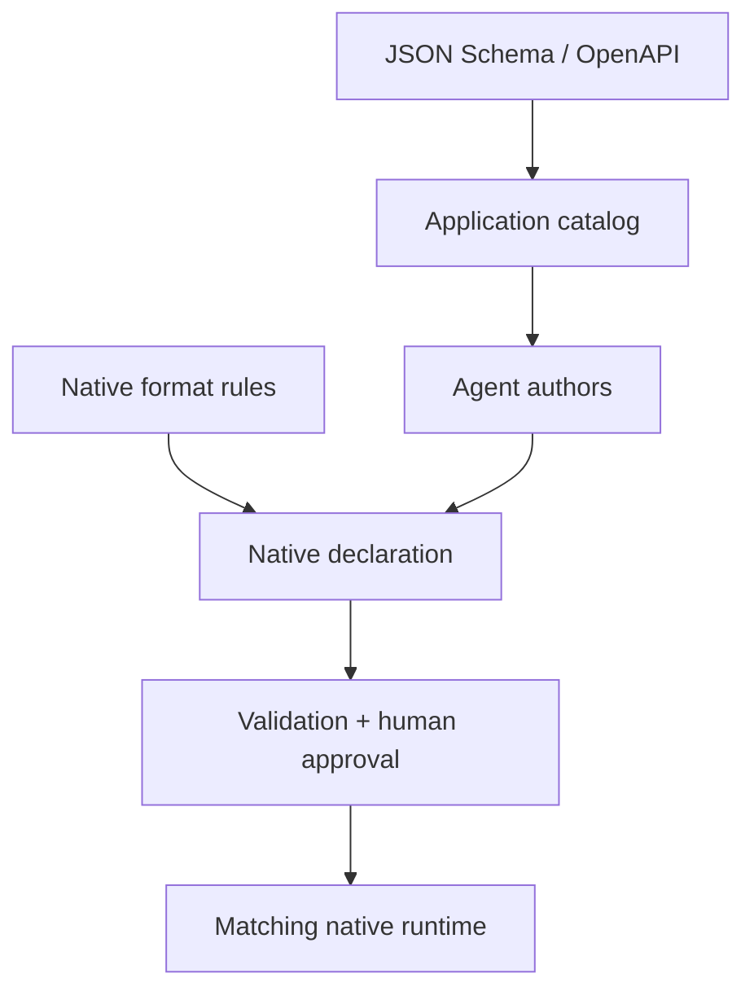

# Proposal: describe the work an agent may assemble

**Exploratory, non-normative. No AAPI wire format or conformance claim is defined.**

## The question

A callable API tells a client how to make a request. A workflow language can say how several requests are ordered. A planning model can describe prerequisites and effects. An application may already have all three, plus trusted executors and an approval process.

We are asking whether a small, reusable way of presenting these existing definitions would help agents assemble work correctly across applications. That presentation should expose meaning and permitted composition before the agent writes a work order. It should not replace the application's runtime, broaden its authority, or treat tool descriptions as executable code.

The immediate target is agent-authored declarations, not agents operating as workflow participants. The agent prepares the proposal and stops. A human UI can submit the same declaration through the same validation and execution path.

## What the application would publish

The table below is a set of candidate requirements for discussion, **not proposed JSON field names**. An existing standard, an application-specific profile, ordinary documentation, or generated views may already provide them.

| Information | Why the agent needs it | Enforcement boundary |
|---|---|---|
| Purpose and applicability | Select the right capability; avoid plausible but wrong substitutes | Application checks supported operations and admissible contexts |
| Identity and version | Refer to a particular approved component/method | Resolver accepts pinned, trusted definitions |
| Typed inputs and outputs | Fill required values; bind one result to another input | Schema checks plus application-specific validation |
| Prerequisite state and effects | Know what must already hold and what changes | Current-state checks and outcome verification |
| Task/method hierarchy | Discover an approved decomposition and its alternatives | Submitted structure must match permitted compositions |
| Execution order | Know **whether order is required and what that order is** | Validate the declared sequence or partial order |
| Unordered or parallel work | Recognize permitted independence, not assume it | Resource/conflict rules determine allowed concurrency |
| Failure behavior | Understand waits, retries, compensation and limits | Trusted runtime applies bounded recovery semantics |
| Clarification needs | Recognize a missing human choice | Unresolved decisions prevent final approval/execution |

Explanations, examples and terminology are advisory context. Preconditions, bounds, dependencies and allowed composition rules must be represented or mapped to checks the application actually enforces. An unknown annotation must not silently become an enforced guarantee.

## Four different relationships

These relationships are often conflated:

1. **Hierarchy:** “activate a customer” decomposes into billing, service activation and reporting access.
2. **State prerequisite:** billing must be configured before activation.
3. **Data flow:** the returned billing record ID becomes an activation input.
4. **Execution ordering:** the reporting action follows successful activation, even if both actions already know the customer ID.

A fifth concern, shared resources, may prohibit simultaneous execution even when there is no data-flow edge. Conversely, two independent infrastructure resources may be created in either order if the approved policy permits it.

A sequence is a total order. A partial order requires only specified predecessor relationships; it does not automatically guarantee concurrency is safe. Form-field display order is a different concept again. Metadata such as a UI's `x-order` must not be interpreted as execution order.

## Authoring without execution authority

The authoring agent receives approved definitions and authorized read-only context. It asks for missing targets, limits and preferences rather than treating absence as a default. It emits the runtime's existing declaration and the concrete inputs or selections that belong to that proposal.

A trusted application then:

- Resolves component references and checks supported versions, types, allowed operations, prerequisites, cycles, ordering and permitted parallel combinations.
- Produces a preview from the same resolved representation that will execute, including effects, targets, unresolved conditions and recovery limits.
- Obtains the required human decision bound to the declaration, inputs, target environment and referenced versions. Mutable references must be resolved or pinned before approval.
- Rechecks relevant state and authority before effects. Material changes require a new review; retries cannot broaden the approved scope.
- Executes through established product functions and records success, partial effects, failure and uncertain outcomes.

The application must specify how output-bound values and conditional paths fit the approval. Approving a fixed binding to an output from the same customer is different from letting the model choose a different customer later. A digest alone does not explain an action to a person.

No model response, description, suggested action or schema annotation is an approval credential. Removing mutation credentials from the authoring process is necessary to preserve this pattern; instruction text alone is insufficient. Production identity, policy and approval integrations remain deployment responsibilities, not implemented features of this repository.

## Reuse first

The standards occupy different layers; select a compatible native format/runtime pair.

Text equivalent: schemas and API descriptions help define the catalog; the agent writes a native declaration under the chosen format's rules. Validation and approval precede the matching runtime. CloudFormation templates target CloudFormation; Arazzo targets a compatible Arazzo executor; Open Workflow targets a compatible Open Workflow runtime. One engine is not assumed to execute every dialect.

Keep a native one-operation declaration where that meets the application's needs. For multiple operations, try the existing workflow/resource language, catalog reuse and supported extensions before introducing a new representation. A compiler, planner or adapter is optional and should solve a demonstrated mismatch.

The [worked examples](README.md#read-and-challenge) deliberately use existing formats. CloudFormation already captures resource dependencies. Arazzo already expresses ordered calls, reusable workflows and output bindings. Open Workflow provides composition constructs and independent runtimes. Formal planning languages already describe methods, prerequisites and effects. The question is which remaining application semantics, if any, need a shared profile.

A profile would need to identify required features, source versions, vocabulary meaning and refusal behavior. It would not be honest to call arbitrary `x-*` metadata portable if each application interprets it differently or a runtime ignores it.

## What would justify additional work?

Start with these two examples. Ask maintainers to encode the same requirements using existing mechanisms, keeping the agent outside execution. Compare what can be discovered, what is validated and what remains application code.

Then repeat the exercise with independently implemented applications. A useful counterexample is a valid native declaration that violates an important composition rule that cannot be expressed or mapped without private conventions. A useful negative result is that documented native mechanisms already solve the problem.

At present we have an architecture pattern and an exploration of a possible interoperability profile/specification. A standard would require independent implementations, interoperability evidence, adoption and governance. This repository establishes none of those and makes no novelty claim.
