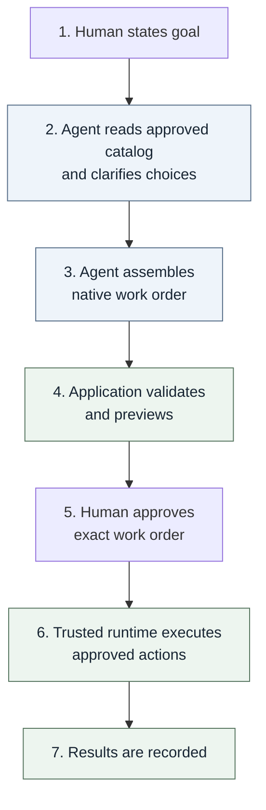

# AAPI: agent-authored application work orders

**Agentic Application Programming Interface — exploratory discussion draft, 2026-11-24.**

How should an application describe its approved building blocks so an agent can assemble work from a conversation, while the application retains execution authority?

This repository is a request for input, not a released protocol, a new industry standard, or a working general-purpose framework. We want to reuse existing declarations, catalogs and runtimes. **“Existing formats already cover this; here is how” is a successful outcome.**

The pattern under discussion is:

Text equivalent: (1) the human states the goal; (2) the agent reads the approved catalog and clarifies missing choices; (3) the agent assembles the native work order; (4) the application validates and previews it; (5) the human approves that exact work; (6) the trusted runtime executes the approved actions; (7) results are recorded. Blue boxes are agent authoring; green boxes are application responsibilities.

The authoring agent has no apply or domain-mutation permissions. It cannot grant approval or invent executable components. A second agent may critique intent, but cannot waive deterministic checks.

## Read and challenge

- [Proposal and candidate semantics](PROPOSAL.md)
- [Infrastructure example: native CloudFormation](examples/cloudformation/README.md)
- [Customer activation: native Arazzo plus an Open Workflow mapping](examples/customer-service/README.md)
- [Prior art, overlap and compatibility](PRIOR_ART.md)
- [Questions for maintainers and implementers](FEEDBACK.md)
- [What has and has not been validated](VALIDATION.md)
- [Contributing](CONTRIBUTING.md)

The examples are fictional and illustrative. No application endpoints, credentials, deploy commands or runtime are supplied. Native schemas can establish structural validity; they do not establish authorization or prove application effects.

## License and authorship

Original documents and examples are available under the [MIT License](LICENSE). Linked specifications retain their respective licenses.

This draft was prepared with AI assistance for research, writing and static checks. Maintainers remain responsible for its claims. No independent human review or standards-body endorsement is claimed.
