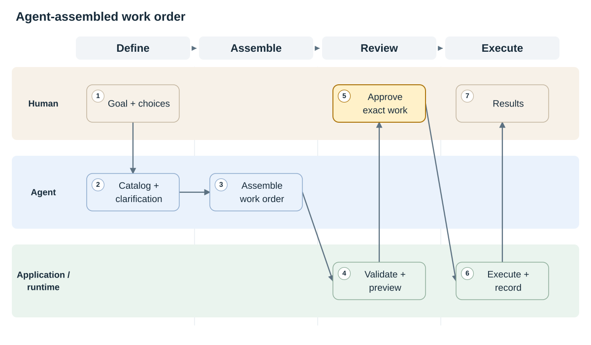

# AAPI: agent-authored application work orders

**Agentic Application Programming Interface — exploratory discussion draft, 2026-11-24.**

How should an application describe its approved building blocks so an agent can assemble work from a conversation, while the application retains execution authority?

This repository is a request for input, not a released protocol, a new industry standard, or a working general-purpose framework. We want to reuse existing declarations, catalogs and runtimes. **“Existing formats already cover this; here is how” is a successful outcome.**

The pattern under discussion is:

Text equivalent: the columns progress through Define, Assemble, Review and Execute; the rows show Human, Agent and Application/runtime responsibilities. (1) The human states the goal and choices; (2) the agent reads the approved catalog and clarifies missing choices; (3) the agent assembles the native work order; (4) the application validates and previews it; (5) the human approves that exact work; (6) the trusted runtime executes and records the approved actions; (7) the human receives the results. The agent does not execute the business actions.

The authoring agent has no apply or domain-mutation permissions. It cannot grant approval or invent executable components. A second agent may critique intent, but cannot waive deterministic checks.

## Read and challenge

- [Proposal and candidate semantics](PROPOSAL.md)
- [Infrastructure example: native CloudFormation](examples/cloudformation/README.md)
- [Reproducible customer activation: trusted methods, Arazzo and Open Workflow](examples/customer-service/README.md)
- [Real native catalog/runtime experiment and results](experiments/native-runtime/README.md)
- [Prior art, overlap and compatibility](PRIOR_ART.md)
- [Questions for maintainers and implementers](FEEDBACK.md)
- [What has and has not been validated](VALIDATION.md)
- [Contributing](CONTRIBUTING.md)

The [customer experiment](examples/customer-service/README.md) includes two pinned methods, constrained author submissions, controlled state/ownership negatives and an offline checker. It demonstrates method selection and parameter substitution, not arbitrary composition. See [exact reproduction commands](VALIDATION.md).

The declaration examples are fictional. A separate native experiment runs a released workflow runtime against owned localhost mocks; no real business/cloud service or credentials are supplied. Native schemas can establish structural validity, not authorization. The measured experiment distinguishes native runtime behavior from mock application guards and untested production integration.

## License and authorship

Original documents and examples are available under the [MIT License](LICENSE). Vendored upstream schemas are Apache-2.0 with [notices](schemas/README.md); linked specifications retain their respective licenses.

This draft was prepared with AI assistance for research, writing and static checks. Maintainers remain responsible for its claims. No independent human review or standards-body endorsement is claimed.
