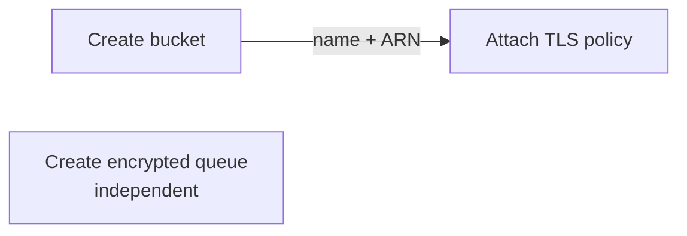

# Example: storage and an independent queue

**Illustrative native CloudFormation; no resources have been deployed.**

## Human request and clarification

Fictional request: “Prepare a private S3 bucket with TLS-only client access and an independent encrypted work queue. Do not deploy.”

The authoring agent asks for target account/region, retention and whether application access grants are needed. Fictional answers: use the designated training sandbox in `us-east-1`; retain the bucket and its policy on stack deletion; delete the queue on teardown; no application IAM grants. A real runner must resolve and verify the target account before approval. No account ID or credential is provided here.

## Application-approved components

This is a hypothetical application's allowlist, not a new CloudFormation schema or an implemented policy engine.

| Component | Purpose and inputs | Prerequisite/effect |
|---|---|---|
| `AWS::S3::Bucket` | Private storage; public access blocked; SSE-S3 encryption | Creates a bucket; outputs its name and ARN |
| `AWS::S3::BucketPolicy` | Deny insecure transport to that bucket and its objects | Bucket must exist; policy references its name/ARN |
| `AWS::SQS::Queue` | Independent work queue with SQS-managed encryption | Creates a queue; no dependency on the bucket |

The approved method “storage plus queue” permits the queue and bucket to be created independently. Policy attachment follows bucket creation. Permission for this independence comes from the application's approved component policy, not from the agent assuming that missing edges imply safety.

## Agent-produced native declaration

[template.json](template.json) uses `AWSTemplateFormatVersion: 2010-09-09`, resource types/properties and intrinsic references. There is no AAPI extension.

Text equivalent: create the bucket before attaching its policy. The queue has no dependency on either and may be created independently under this example's approved policy. The labeled arrow carries data and implies required order.

The policy's `Ref` and `Fn::GetAtt` express **data flow** and imply a **creation dependency**. Bucket and queue creation may be concurrent; attaching the policy before the bucket exists is invalid. Resource order in the JSON object is not an execution schedule.

The JSON declares allowed work, not permission to submit or execute it. The authoring agent has no CloudFormation execution or domain-write credentials.

## Invalid case

[invalid-cycle.json](invalid-cycle.json) adds `LogsBucket.DependsOn: TransportPolicy`. The policy already depends on the bucket through references, forming a cycle. It is valid JSON, but it is an invalid resource graph. An independent validator must reject it before applying anything. This expected rejection was checked by static graph inspection, not by a CloudFormation deployment.

## Human preview and executor responsibility

Illustrative preview:

- Target: the confirmed training sandbox, `us-east-1`; resolve the real account before approval.
- Create one private, encrypted bucket and one independently created encrypted queue; attach a policy denying insecure transport.
- Create no application access grant. The policy's wildcard principal is within a **Deny**, not a public-access grant.
- Retain bucket and policy when deleting the stack; queue deletion removes queued messages.
- Cost and existing organizational policy must be evaluated for the actual target before approval.

The trusted deployment service validates native syntax/resource constraints and application policy, creates/reviews the native change set, binds the approved template/target/parameters/change set, and executes only after approval. It must also handle change-set invalidation and provider failures. This repository implements none of that integration.

## Native coverage and possible gap

CloudFormation already supplies resource typing, references, dependency ordering and an executor. Its [dependency rules](https://docs.aws.amazon.com/AWSCloudFormation/latest/TemplateReference/aws-attribute-dependson.html), [bucket](https://docs.aws.amazon.com/AWSCloudFormation/latest/TemplateReference/aws-resource-s3-bucket.html), [bucket policy](https://docs.aws.amazon.com/AWSCloudFormation/latest/TemplateReference/aws-resource-s3-bucketpolicy.html) and [queue](https://docs.aws.amazon.com/AWSCloudFormation/latest/TemplateReference/aws-resource-sqs-queue.html) definitions are the authorities.

The open question is whether approved-method applicability, human clarification needs and application constraints can be published using existing catalog/documentation mechanisms. No additional metadata grammar is introduced to manufacture a gap.

[Validation limits](../../VALIDATION.md) · [Feedback questions](../../FEEDBACK.md)
