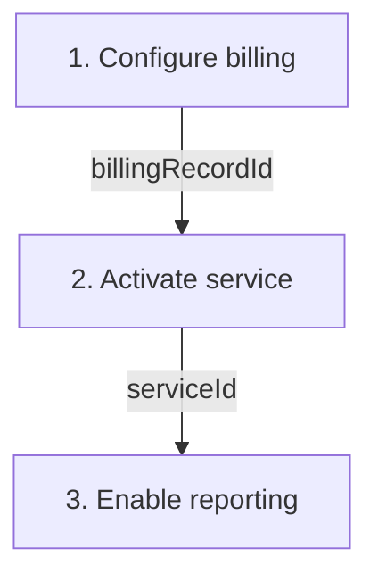

# Reproducible example: choose an approved customer method

**Offline experiment with fictional state and API. No LLM, HTTP service or workflow runtime is executed.**

## What this demonstrates

An author can choose between **two application-owned methods** and supply one permitted customer input:

- `monthly-with-reporting`: billing → activation → reporting.
- `monthly-without-reporting`: billing → activation.

Both have native Arazzo 1.0.1 and Open Workflow 1.0.1 declarations. This demonstrates **method selection plus parameter substitution**, not arbitrary component composition, a general planner or an agent benchmark. The application's trust boundary is explicit; an artifact calling itself “approved” has no authority.

Run all positive and negative cases from the repository root:

```sh
python3 tools/check_examples.py
```

Dependency installation and the full reproduction command are in [VALIDATION.md](../../VALIDATION.md).

## Illustrative conversation and exact author inputs

This exchange is invented for the example, not a user transcript or a recorded LLM run.

> Human: Activate the standard monthly service for customer-example.
>
> Agent: The approved catalog offers activation with or without reporting. Should reporting be enabled?
>
> Human: Yes. Configure monthly billing only; do not collect payment or create historical invoices.
>
> Agent: I will select monthly-with-reporting and submit customer-example for application review. I cannot execute it.

Reporting is genuinely unspecified in the first request; the agent must not guess. With “No,” it selects the second method. The agent-readable starting set is [approved-catalog.json](approved-catalog.json), the referenced native declarations, [openapi.json](openapi.json) and this document. The catalog exposes purpose, permitted inputs, component guard identifiers, predicted effects and each allowed operation order.

The resulting [with-reporting submission](submissions/with-reporting.json) is deliberately small:

```json
{"method":"monthly-with-reporting","inputs":{"customerId":"customer-example"}}
```

[without-reporting.json](submissions/without-reporting.json) is the second valid choice. This selection envelope and catalog are **custom metadata for this fictional application**, not standardized AAPI syntax or a proposed universal grammar. The native definitions use existing standards.

## Trusted admission and allowed edits

The bounded checker loads the catalog from its fixed repository location, not from the author submission. Its trust assumption is an operator-controlled checkout at a reviewed commit. Hashes detect changed referenced bytes relative to that catalog; they are not signatures and do not protect a compromised checkout or malicious catalog maintainer.

| Surface | Owner | Allowed author change | Admission rule |
|---|---|---|---|
| Submission | Authoring agent/person | Choose one catalog method; set `inputs.customerId` | Exactly `method` and `inputs`; validate permitted method and input schema |
| Native declarations | Application | None | Resolve only catalog paths and require pinned file hashes |
| API contract and target | Application | None | Require pinned API bytes; fictional target remains `service.example.invalid` |
| Guards and fixture observations | Application/checker | None | Evaluate actual state/ownership values; never take an author-supplied approval or guard result |
| Runtime execution/approval | Application | None | Not implemented in this offline experiment |

An input change does not change the method's billing cycle, package, operation order, endpoints or data bindings. Unknown methods and an extra `approved: true` field are negative cases. This table describes the experiment's admission scope, not a production authentication system.

## Three kinds of prerequisite

| When | What is checked or predicted | Where the example shows it |
|---|---|---|
| Initial preflight | Selected customer exists and is eligible | `scenario.initial`; an initially ineligible customer is refused before any hypothetical operation |
| Planning | Successful billing is expected to establish billing configured; successful activation is expected to establish an active service | Approved method order and component `predictedEffect` text; these are expected future effects, not initially required facts |
| Immediately before each operation | Customer is still eligible; activation additionally needs the returned monthly billing record to belong to that customer; reporting needs that customer's active service | Fresh `observations[].before` snapshot for each hypothetical operation |
| After a hypothetical result | Response schema and selected output binding are checked | `observations[].response`; no live outcome is asserted |

The valid initial state has **no billing record and no service**. It still passes preflight: demanding predecessor effects at the start would reject valid work. Later snapshots represent observed results, not facts inferred solely from a successful status. The drift case revokes eligibility after billing; the activation guard refuses.

[fixtures/state.json](fixtures/state.json) contains the controlled observations. [fixtures/cases.json](fixtures/cases.json) contains expectations that are compared with derived decisions; expected strings do not drive the checks. `guardPassed` lists only guards passed in an offline traversal, not executed operations.

## Native work orders

| Method | Arazzo 1.0.1 | Open Workflow 1.0.1 |
|---|---|---|
| Monthly with reporting | [work-order.arazzo.json](work-order.arazzo.json) | [with-reporting.openworkflow.json](with-reporting.openworkflow.json) |
| Monthly without reporting | [without-reporting.arazzo.json](without-reporting.arazzo.json) | [without-reporting.openworkflow.json](without-reporting.openworkflow.json) |

Arazzo uses ordered `steps`, `operationId`, request bodies, success criteria and output expressions. Open Workflow uses ordered `do` HTTP tasks, inline input/output schemas, the immutable `$workflow.input.customerId` and the preceding task's output. Both call the same fictional OpenAPI operations with the same projected payloads.



Text equivalent: billing configuration precedes activation; the reporting method then enables reporting. The arrows require order; labels are output-to-input bindings. The without-reporting method stops after activation. State prerequisites and data flow remain distinct from ordering.

Versions are pinned for reproducibility, not described as latest. [Arazzo 1.1.0](https://spec.openapis.org/arazzo/v1.1.0.html) and [Open Workflow 1.1.0](https://open-workflow-specification.org/blog/releases/release-110/) are newer releases. No unreleased actor-in-the-loop fields are used.

### Open Workflow mapping

The former construct-only sketch is now two actual declarations checked against the official 1.0.1 schema. HTTP task bodies consume `${ .billingRecordId }` and `${ .serviceId }`; endpoint expressions read `$workflow.input.customerId` so the customer survives changes to the intermediate payload. The checker recognizes those exact expressions and compares their call/binding projection with Arazzo. It does **not** run jq or prove full runtime equivalence, HTTP error handling, retries or persistence.

## Negative cases with different meanings

- **Native order:** [invalid-order.arazzo.json](invalid-order.arazzo.json) passes the document schema but reports an unavailable forward output. It is not a trusted catalog declaration, so it is also inadmissible.
- **Application semantics:** `wrong-customer-billing` uses the unchanged approved declaration, correct sequence, valid input and a schema-valid string output. The fixture returns `billing-other`, whose authoritative record belongs to `customer-other`. The activation guard returns `billing-owner-mismatch`; activation/reporting are not admitted. Type correctness and ordering cannot establish record ownership.
- **Temporal state:** `initially-ineligible` fails initial preflight; `eligibility-drift` starts eligible but fails immediately before activation.
- **Author authority:** unknown methods and self-approval fields fail admission.

Inspect the semantic negative alone:

```sh
python3 tools/check_examples.py --case wrong-customer-billing
```

The checker exits nonzero if a case is unexpectedly accepted or refused, a positive check fails, a negative is not detected, a pinned definition/schema changes, or a local link breaks.

## Human preview and production boundary

Illustrative preview: for customer-example, configure monthly billing and activate standard service, with reporting only if the chosen method includes it. No payment collection or historical invoicing. Show the selected method, inputs, target, definition versions and output bindings before asking for exact-work approval.

The package supplies no human-approval ceremony, credentials, production policy store, executor or API implementation. A real integration must independently enforce admission, protect the catalog, bind approval, recheck actual state, manage uncertain effects and report partial outcomes. There are no automatic retry or rollback claims.

Arazzo/Open Workflow already cover the declared sequence and bindings. This small experiment asks whether the remaining catalog/guard semantics should stay application metadata or map to an existing interoperable profile. It does not establish the need for a new language.

[Validation limits](../../VALIDATION.md) · [Feedback questions](../../FEEDBACK.md)
